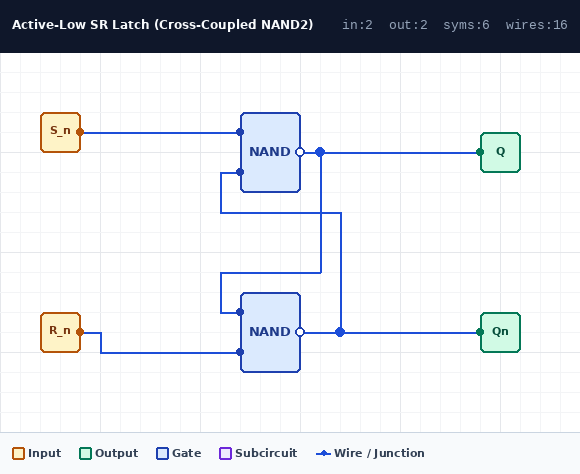

# pylogiccircuit

[](https://github.com/Kameil/pylogiccircuit/actions/workflows/ci.yml)


**Construa, roteie automaticamente, verifique, simule e renderize circuitos digitais do [LogicCircuit](https://www.logiccircuit.org/) (`.CircuitProject`) programaticamente em Python.**

- **Zero dependências obrigatórias** no núcleo (100% biblioteca padrão do Python 3.10+).
- **Prévia visual em PNG** opcional via `Pillow` (`pip install "pylogiccircuit[preview]"`).
- **Compatível 1:1 com o formato XML XSD `2.0.0.14`** e com o motor de avaliação FIFO do LogicCircuit.

---

## Prévia Gerada pela Própria Biblioteca (`pylogiccircuit.preview`)

<table>
  <tr>
    <td align="center">
      <br/>
      <sub><b>Half Adder (1-bit)</b> — <a href="examples/half_adder.py">examples/half_adder.py</a></sub>
    </td>
    <td align="center">
      <br/>
      <sub><b>Latch SR Sequencial (NAND2)</b> — sem oscilação</sub>
    </td>
  </tr>
</table>

<p align="center">
  <br/>
  <sub><b>ALU 4-bit 74LS382 / 74HC382</b> gerada, roteada automaticamente e verificada em <b>4096/4096</b> combinações — <a href="examples/alu_4bit_74ls382.py">examples/alu_4bit_74ls382.py</a></sub>
</p>

---

## Documentação Completa

| Documento | Conteúdo |
| --- | --- |
| [**Estado Atual do Projeto (`v0.1.0`)**](docs/PROJECT_STATUS.md) | Inventário de módulos, métricas reais, matriz de compatibilidade com o LogicCircuit, limitações conhecidas e roadmap |
| [**Arquitetura Técnica**](docs/ARCHITECTURE.md) | Pipeline completo, codificação de GUIDs, geometria de subcircuitos, roteador ortogonal A\*, verificador de curtos e simulador FIFO |
| [**Referência da API**](docs/API_REFERENCE.md) | Documentação detalhada de todas as classes, métodos, parâmetros e receitas práticas |
| [**Guia Prático, Galeria Visual & CLI**](docs/GUIDE_AND_EXAMPLES.md) | Exemplos comentados com todas as 6 imagens do `preview` (`HalfAdder`, `FullAdder`, `Adder4Bit`, `BitMux`, `ALU_74LS382`, `SRLatch`) e guia completo da CLI |

---

## Recursos Principais

- **Builder Python Fluente**: crie `Project` e `Circuit` com entradas, saídas, portas nativas (`NOT`, `AND`, `NAND`, `OR`, `NOR`, `XOR`, `XNOR`, `CLOCK`, `LED`) e subcircuitos hierárquicos reutilizáveis.
- **Roteador Ortogonal A\***: traça fios na grade respeitando as regras reais do LogicCircuit (cruzamentos perpendiculares sem curto, *stubs* protegidos, *escape guards*, junções em T e *rip-up-and-reroute*).
- **Verificador Exato de Conectividade**: detecta curtos-circuitos, redes desconexas, pinos tocados acidentalmente e fios diagonais antes mesmo de abrir o LogicCircuit.
- **Simulador FIFO Compatível com o LogicCircuit**: achata hierarquias de subcircuitos, respeita pinos invertidos, gera tabelas-verdade completas e detecta oscilações reais.
- **Leitura e Edição de `.CircuitProject` Existentes**: carregue projetos feitos na interface do LogicCircuit com `Project.load()`, audite, simule ou gere prévias PNG.
- **Renderizador de Prévia PNG & CLI**: gere imagens limpas dos esquemáticos e use `pylogiccircuit list | verify | truth-table | render` direto no terminal.

---

## Instalação

```bash
# Núcleo (zero dependências externas)
pip install git+https://github.com/Kameil/pylogiccircuit.git

# Com suporte a prévia em PNG (Pillow)
pip install "pylogiccircuit[preview] @ git+https://github.com/Kameil/pylogiccircuit.git"
```

Para desenvolvimento local:

```bash
git clone https://github.com/Kameil/pylogiccircuit.git
cd pylogiccircuit
pip install -e ".[dev]"
pytest -v
```

---

## Quick Start

```python
from pylogiccircuit import Gate, Project, Simulator, render_circuit_png

proj = Project("Half Adder Demo")
ha = proj.add_circuit("HalfAdder", notation="HA")

a = ha.add_input("A", x=2, y=2)
b = ha.add_input("B", x=2, y=8)

xor_gate = ha.add_gate(Gate.XOR2, x=10, y=2)
and_gate = ha.add_gate(Gate.AND2, x=10, y=8)

s = ha.add_output("S", x=18, y=3)
c = ha.add_output("C", x=18, y=9)

ha.connect(a, xor_gate.in_[0], and_gate.in_[0])
ha.connect(b, xor_gate.in_[1], and_gate.in_[1])
ha.connect(xor_gate.out, s)
ha.connect(and_gate.out, c)

ha.auto_route()
proj.save("half_adder.CircuitProject")
render_circuit_png(ha, "half_adder.png", scale=20)

sim = Simulator.from_project(proj)
print(sim.truth_table("HalfAdder").format_markdown())
```

---

## Uso pela CLI

```bash
pylogiccircuit list meu_projeto.CircuitProject
pylogiccircuit verify meu_projeto.CircuitProject
pylogiccircuit truth-table meu_projeto.CircuitProject --circuit HalfAdder
pylogiccircuit render meu_projeto.CircuitProject --circuit HalfAdder -o preview.png --scale 18
```

---

## Licença

MIT License — consulte [LICENSE](LICENSE).
