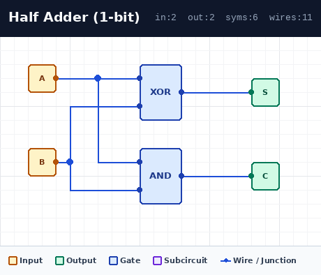
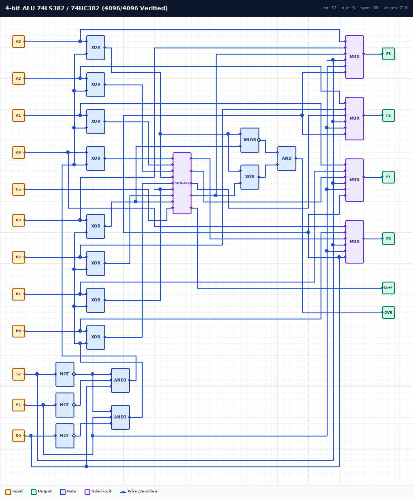

# pylogiccircuit

[](https://github.com/Kameil/pylogiccircuit/actions/workflows/ci.yml)


**Programmatically build, auto-route, verify, simulate, and render [LogicCircuit](https://www.logiccircuit.org/) (`.CircuitProject`) digital circuits in Python.**

- **Zero required core dependencies** (100% Python 3.10+ standard library).
- **Optional PNG schematic previews** powered by `Pillow` (`pip install "pylogiccircuit[preview]"`).
- **1:1 compatible with LogicCircuit's XML XSD `2.0.0.14`** and its FIFO evaluation engine.

---

## Previews Rendered by `pylogiccircuit.preview`

<table>
  <tr>
    <td align="center">
      <br/>
      <sub><b>Half Adder (1-bit)</b> — <a href="examples/half_adder.py">examples/half_adder.py</a></sub>
    </td>
    <td align="center">
      <br/>
      <sub><b>Sequential SR Latch (NAND2)</b> — oscillation-free</sub>
    </td>
  </tr>
</table>

<p align="center">
  <br/>
  <sub><b>4-bit ALU 74LS382 / 74HC382</b> built, auto-routed, and exhaustively verified across all <b>4096/4096</b> combinations — <a href="examples/alu_4bit_74ls382.py">examples/alu_4bit_74ls382.py</a></sub>
</p>

---

## Documentation

| Document | Contents |
| --- | --- |
| [**Project Status (`v0.1.0`)**](docs/PROJECT_STATUS.md) | Module inventory, exact metrics, LogicCircuit compatibility matrix, known limitations, and roadmap |
| [**Technical Architecture**](docs/ARCHITECTURE.md) | End-to-end pipeline, built-in gate GUID encoding, subcircuit geometry, orthogonal A\* router, connectivity verifier, and FIFO simulator |
| [**API Reference**](docs/API_REFERENCE.md) | Complete documentation of every public class, method, parameter, return type, and practical recipes |
| [**Guide, Visual Gallery & CLI**](docs/GUIDE_AND_EXAMPLES.md) | Walkthroughs with all 6 generated `preview` PNGs (`HalfAdder`, `FullAdder`, `Adder4Bit`, `BitMux`, `ALU_74LS382`, `SRLatch`) and CLI usage |
| [**Live Preview in Zed**](docs/ZED_LIVE_PREVIEW.md) | Side-by-side live schematic preview inside Zed (`.zed/tasks.json` + `pylogiccircuit watch`) and optional local web viewer |

---

## Key Features

- **Fluent & Class-Based Builders**: Build quick sheets imperatively with `Project`/`Circuit`, or author reusable typed chips with `Component`, `Input`, `Output`, and `self.use(...)` (full IDE pin autocomplete + automatic subcircuit deduplication).
- **Standard Library (`pylogiccircuit.stdlib`)**: 12 ready-to-use, tested blocks — `HalfAdder`, `FullAdder`, `Adder4Bit`, `Mux2to1`, `Mux4to1`, `Decoder2to4`, `SRLatch`, `SRFlipFlop`, `DFlipFlop`, `DFlipFlopAsync` (with `~PRE`/`~CLR`), `JKFlipFlop`, and `TFlipFlop`.
- **Orthogonal A\* Auto-Router**: Routes nets on LogicCircuit's grid while respecting exact crossing and T-junction semantics (non-connecting perpendicular crossings, protected pin stubs, escape guards, and rip-up-and-reroute).
- **Exact Connectivity Verifier**: Detects unintended short circuits, disconnected nets, accidentally touched pins, and diagonal wires before you even open LogicCircuit.
- **LogicCircuit-Compatible FIFO Simulator**: Flattens nested subcircuits, handles inverted pins, runs full truth-table sweeps, and detects real oscillations.
- **Load & Inspect Existing `.CircuitProject` Files**: Parse projects authored in LogicCircuit's GUI with `Project.load()`, verify connectivity, run truth tables, or render PNG previews.
- **PNG Preview Renderer & CLI**: Render publication-grade PNG schematics and run `pylogiccircuit list | verify | truth-table | render` from the terminal.

---

## Installation

```bash
# Core library (zero external dependencies)
pip install git+https://github.com/Kameil/pylogiccircuit.git

# With optional PNG schematic preview support (Pillow)
pip install "pylogiccircuit[preview] @ git+https://github.com/Kameil/pylogiccircuit.git"
```

For local development:

```bash
git clone https://github.com/Kameil/pylogiccircuit.git
cd pylogiccircuit
pip install -e ".[dev]"
pytest -v
```

---

## Quick Start

```python
from pylogiccircuit import Gate, Project, Simulator, render_circuit_png

proj = Project("Half Adder Demo")
ha = proj.add_circuit("HalfAdder", notation="HA")

a = ha.add_input("A", x=2, y=2)
b = ha.add_input("B", x=2, y=8)

xor_gate = ha.add_gate(Gate.XOR2, x=10, y=2)
and_gate = ha.add_gate(Gate.AND2, x=10, y=8)

s = ha.add_output("S", x=18, y=3)
c = ha.add_output("C", x=18, y=9)

ha.connect(a, xor_gate.in_[0], and_gate.in_[0])
ha.connect(b, xor_gate.in_[1], and_gate.in_[1])
ha.connect(xor_gate.out, s)
ha.connect(and_gate.out, c)

ha.auto_route()
proj.save("half_adder.CircuitProject")
render_circuit_png(ha, "half_adder.png", scale=20)

sim = Simulator.from_project(proj)
print(sim.truth_table("HalfAdder").format_markdown())
```

---

## CLI Usage

```bash
pylogiccircuit list my_project.CircuitProject
pylogiccircuit verify my_project.CircuitProject
pylogiccircuit truth-table my_project.CircuitProject --circuit HalfAdder
pylogiccircuit render my_project.CircuitProject --circuit HalfAdder -o preview.png --scale 18
pylogiccircuit watch examples/half_adder.py -o .pylogiccircuit_preview.png --md .pylogiccircuit_preview.md
```

---

## License

MIT License — see [LICENSE](LICENSE).
