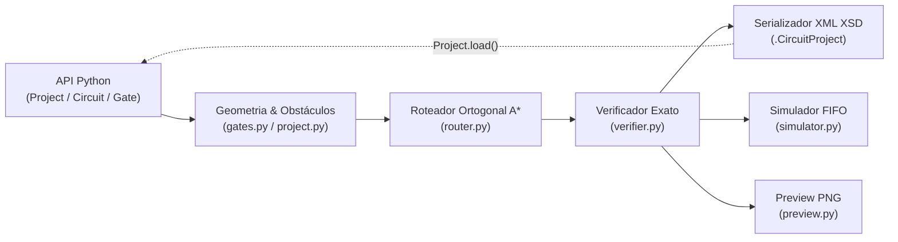
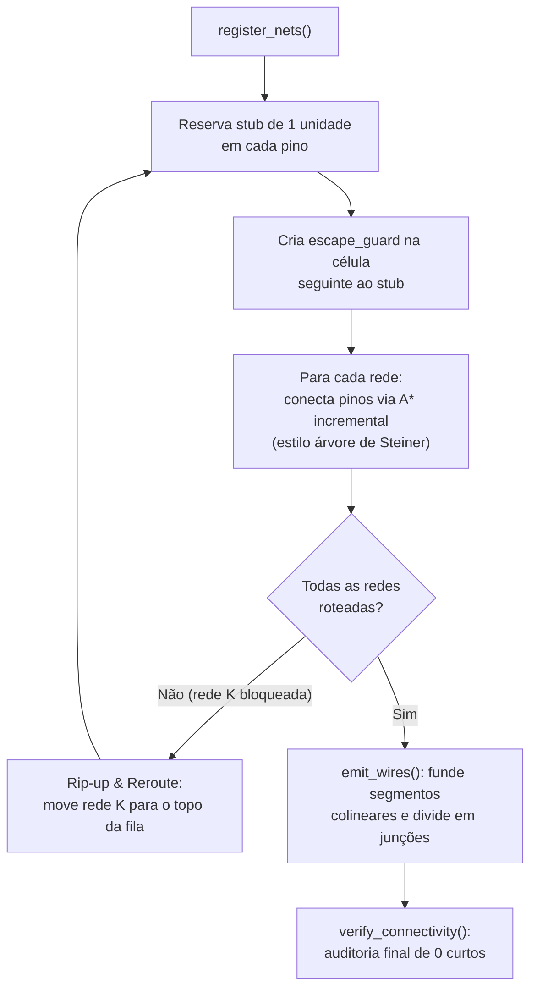

# Arquitetura Técnica

Este documento explica como a **`pylogiccircuit`** funciona internamente — desde a declaração de um circuito em Python até a geração do XML válido do LogicCircuit, verificação geométrica, simulação FIFO e renderização da prévia em PNG.

---

## 1. Visão Geral do Pipeline



Cada etapa é desacoplada e pode ser usada independentemente:
- Você pode **construir do zero** com `Project` + `Circuit` + `auto_route()`.
- Ou **carregar um arquivo existente** criado na interface gráfica do LogicCircuit com `Project.load()`, verificar com `verify()`, simular com `Simulator` e renderizar com `render_circuit_png()`.

---

## 2. Codificação de Portas e Geometria (`gates.py`)

### 2.1 GUIDs das Portas Nativas do LogicCircuit

No formato XML do LogicCircuit, portas lógicas primitivas não são definidas como subcircuitos — elas são referenciadas por GUIDs fixos no padrão:

```text
00000000-0000-0000-0000-000000{FAMILIA:02d}{ENTRADAS:02d}{INVERTIDA:02d}
```

| Código da Família | Sem Inversão (`00`) | Com Inversão (`01`) | Exemplo (2 entradas) |
| :-: | --- | --- | --- |
| `02` | Buffer | `NOT` (1 entrada) | `00000000-0000-0000-0000-000000020101` |
| `03` | `OR` | `NOR` | `OR2`: `...030200` / `NOR2`: `...030201` |
| `04` | `AND` | `NAND` | `AND2`: `...040200` / `NAND2`: `...040201` |
| `05` | `XOR` | `XNOR` | `XOR2`: `...050200` / `XNOR2`: `...050201` |

Componentes especiais:
- **Clock**: `00000000-0000-0000-0000-000000010000` (`2×2`, saída em `(+2, +1)`)
- **LED (1 bit)**: `00000000-0000-0000-0000-000000080100` (`2×2`, entrada em `(0, +1)`)

A função `parse_gate_guid()` decodifica automaticamente qualquer GUID desse padrão em um objeto `GateSpec`, permitindo simular e renderizar até portas com `3..8` entradas encontradas em arquivos externos.

### 2.2 Dimensões de Portas e Pinos

- **Pino externo (`Input` / `Output`)**: ocupa `2×2` unidades na grade.
  - `Input` em `(x, y)` tem seu ponto de conexão (*jam*) na direita: `(x + 2, y + 1)`.
  - `Output` em `(x, y)` tem seu *jam* na esquerda: `(x, y + 1)`.
- **Porta lógica padrão com $N$ entradas**:
  - Largura fixa $W = 3$.
  - Altura $H = \max(4, N + 1)$.
  - Entradas distribuídas na borda esquerda ($dx = 0$) com passo $\lfloor (H - 2) / (N - 1) \rfloor$ (ou $dy = 2$ para $N = 1$).
  - Saída na borda direita ($dx = 3$) em $dy = \lfloor H / 2 \rfloor$ (ou $dy = 2$ para $N = 1$).

### 2.3 Geometria de Subcircuitos (`compute_subcircuit_layout`)

Quando um `Circuit` é instanciado dentro de outro via `add_subcircuit()`, o LogicCircuit posiciona seus pinos externos seguindo a classe interna `PinComparer`:
- Pinos nos lados `Left` e `Right` são ordenados de **cima para baixo** (`(y, x)`).
- Pinos nos lados `Top` e `Bottom` são ordenados da **esquerda para a direita** (`(x, y)`).
- Dimensões do bloco:
  - $W = \max(3, \max(|Top|, |Bottom|) + 1)$ (ou `3` se não houver pinos em cima/embaixo).
  - $H = \max(4, \max(|Left|, |Right|) + 1)$ (ou `4` se não houver pinos à esquerda/direita).

Replicar essa regra exata garante que os fios roteados pelo Python encaixem pixel-a-pixel nos pinos reais ao abrir o arquivo no LogicCircuit.

---

## 3. Roteador Ortogonal A\* (`router.py`)

O LogicCircuit adota regras muito específicas de conectividade em grade:

1. **Dois fios perpendiculares que se cruzam NÃO conectam** — a menos que uma extremidade (ponta) de fio ou pino caia exatamente sobre o cruzamento.
2. **Qualquer ponta de fio que toque outro segmento cria uma junção elétrica (T-junction)**.
3. **Dois segmentos colineares que se sobrepõem conectam**.

O `OrthogonalRouter` modela essas regras diretamente no espaço de estados do A\* `(x, y, eixo)`:



### Técnicas-chave implementadas
- **Reserva de *stub* (1 célula perpendicular ao pino)**: impede que outra rede cole um fio paralelo rente à borda de uma porta ou bloco.
- **Guarda de escape (*escape guard*)**: na célula logo à frente do *stub*, outras redes podem **atravessar perpendicularmente em linha reta**, mas **não podem fazer curva nem correr paralelamente**. Isso evita que blocos densos (como somadores de 4 bits com 8 pinos adjacentes na base ou MUXes 8:1 com 9 pinos adjacentes) tenham algum pino "emparedado".
- **Reaproveitamento da própria rede**: caminhar sobre segmentos já pertencentes à mesma rede tem custo reduzido (`0.15`), formando bifurcações limpas em T como um humano desenharia.
- **Penalidade de dobra (`bend_cost`) e cruzamento (`cross_cost`)**: prioriza trajetos curtos, retos e limpos visualmente.
- **Quebra de segmentos em junções da mesma rede**: em `emit_wires()`, segmentos horizontais da mesma rede são quebrados nos pontos onde há ramificação vertical da mesma rede, garantindo que o LogicCircuit sempre reconheça cruzamentos em `+` e junções em `T` pertencentes ao mesmo nó elétrico.

---

## 4. Verificador Exato de Conectividade (`verifier.py`)

A função `build_wire_graph()` reconstrói o grafo de conectividade usando exatamente a semântica do LogicCircuit:
- Cada segmento `<Wire X1 Y1 X2 Y2 />` conecta `(X1, Y1)` a `(X2, Y2)` **e** a qualquer outro endpoint ou pino localizado no interior do segmento.
- Segmentos colineares sobrepostos no mesmo `X` ou mesmo `Y` são unidos no mesmo componente conexo.
- Cruzamentos perpendiculares sem endpoint em comum **não** criam aresta.

Sobre esse grafo, `verify_connectivity()` valida:
1. Ausência de fios diagonais (a menos que `allow_diagonal=True`).
2. Cada rede declarada está inteiramente em **1 único componente conexo** (sem fios soltos/divididos).
3. Nenhuma dupla de redes distintas compartilha o mesmo componente (**zero curtos-circuitos**).
4. Nenhum pino não atribuído foi encostado acidentalmente por um fio de outra rede.

---

## 5. Motor de Simulação FIFO (`simulator.py`)

O `Simulator` reproduz fielmente o modelo de avaliação do LogicCircuit (`CircuitState.Evaluate`):

1. **Achatamento hierárquico (*Flattening*)**:
   - Percorre recursivamente cada subcircuito instanciado, criando instâncias independentes das portas internas e fundindo redes de fronteira via **Union-Find** (*Disjoint Set Union*).
   - Pinos de subcircuito marcados com `Inverted="True"` inserem automaticamente um inversor lógico na fronteira.
2. **Propagação por fila FIFO (*DirtyList*)**:
   - Portas cujas entradas mudam entram em uma fila FIFO (`collections.deque`) sem duplicatas (`in_queue`).
   - Cada porta é reavaliada uma de cada vez; se a saída muda, apenas seu *fanout* entra na fila.
   - Esse modelo evita falsos positivos de oscilação em latches SR/JK com portas NAND (que falhariam numa simulação síncrona simultânea) e detecta oscilações reais (como *ring oscillators* ou *race-around* em JK sem detector de borda) ao atingir `max_steps`.
3. **Ordenação de colunas na Tabela-Verdade**:
   - Reproduz a ordenação `PinComparer` do LogicCircuit (`Left` de cima para baixo, `Top`/`Bottom` da esquerda para a direita, `Right` de cima para baixo).
   - Para circuitos com `Clock` interno, alterna o clock a cada linha da varredura, espelhando o comportamento da janela *Truth Table* do LogicCircuit.

---

## 6. Esquema XML `.CircuitProject` (`project.py`)

O LogicCircuit valida rigorosamente a ordem dos elementos filhos em `<CircuitProject xmlns="http://LogicCircuit.net/2.0.0.14/CircuitProject.xsd">`:

1. `<Project />`
2. `<LogicalCircuit />`
3. `<Pin />`
4. Elementos adicionais preservados em `Project.load()` (`<CircuitButton />`, `<Constant />`, `<CircuitProbe />`, `<Sensor />`, `<Memory />`, `<TextNote />`)
5. `<CircuitSymbol />`
6. `<Wire />`

O método `Project.to_xml_tree()` garante sempre essa ordem exata e formatação indentada com `\t` em UTF-8.

---

## 7. Renderizador de Prévia PNG (`preview.py`)

O módulo `preview.py` usa `Pillow` (dependência opcional) para gerar imagens esquemáticas diretamente de qualquer objeto `Circuit`:
- Calcula automaticamente o *bounding box* justo de todos os símbolos e fios.
- Desenha grade principal (a cada 5 unidades) e secundária (a cada 1 unidade).
- Identifica e desenha **pontos de junção elétrica** onde 3+ pontas se encontram ou uma ponta toca o interior de outro fio.
- Aplica paleta semântica de cores (`Input` âmbar, `Output` esmeralda, `Gate` azul, `Subcircuit` roxo, `Clock` rosa, `LED` vermelho) com bolhas de inversão em portas inversoras (`NOT`, `NAND`, `NOR`, `XNOR`).
- Ajusta dinamicamente o tamanho da fonte dentro dos blocos e no cabeçalho para evitar qualquer corte ou sobreposição de texto.
