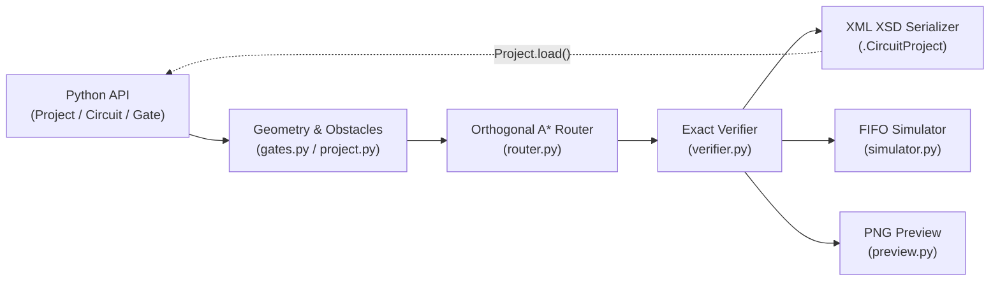
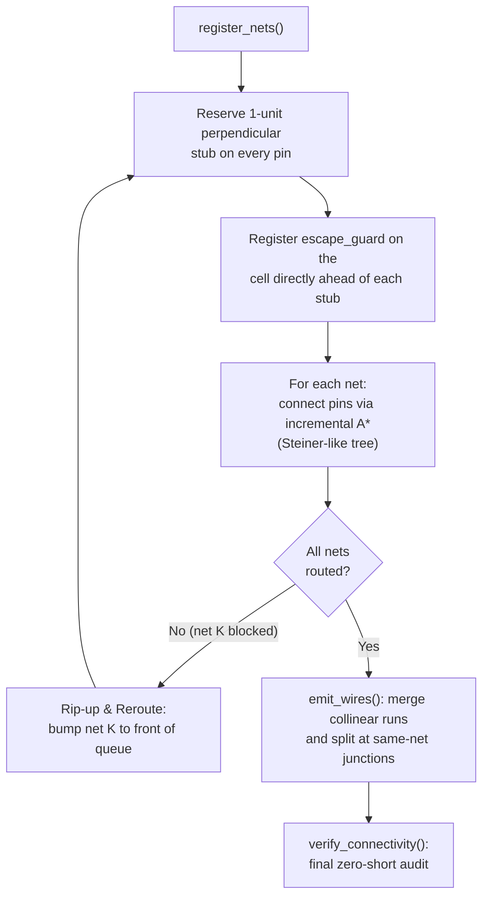

# Technical Architecture

This document describes how **`pylogiccircuit`** works internally — from declaring a circuit in Python to producing valid LogicCircuit XML, verifying connectivity, simulating with FIFO semantics, and rendering PNG schematic previews.

---

## 1. End-to-End Pipeline



Each stage is decoupled and independently usable:
- You can **build circuits from scratch** via `Project` + `Circuit` + `auto_route()`.
- Or **load an existing `.CircuitProject`** created in LogicCircuit's GUI with `Project.load()`, audit it with `verify()`, simulate it with `Simulator`, and render it with `render_circuit_png()`.

---

## 2. Built-in Gates & Pin Geometry (`gates.py`)

### 2.1 LogicCircuit Gate GUID Encoding

In LogicCircuit's XML format, primitive gates are referenced by canonical GUIDs following the pattern:

```text
00000000-0000-0000-0000-000000{FAMILY:02d}{INPUTS:02d}{INVERTED:02d}
```

| Family Code | Non-Inverted (`00`) | Inverted (`01`) | Example (2 inputs) |
| :-: | --- | --- | --- |
| `02` | Buffer | `NOT` (1 input) | `00000000-0000-0000-0000-000000020101` |
| `03` | `OR` | `NOR` | `OR2`: `...030200` / `NOR2`: `...030201` |
| `04` | `AND` | `NAND` | `AND2`: `...040200` / `NAND2`: `...040201` |
| `05` | `XOR` | `XNOR` | `XOR2`: `...050200` / `XNOR2`: `...050201` |

Special primitive components:
- **Clock**: `00000000-0000-0000-0000-000000010000` (`2×2`, output jam at `(+2, +1)`)
- **LED (1-bit)**: `00000000-0000-0000-0000-000000080100` (`2×2`, input jam at `(0, +1)`)

`parse_gate_guid()` decodes any matching GUID into a `GateSpec`, enabling simulation and rendering of arbitrary `1..8`-input gates found in externally created files.

### 2.2 Gate & Pin Grid Dimensions

- **External Pin (`Input` / `Output`)**: occupies `2×2` grid units.
  - `Input` at `(x, y)` connects on the right at `(x + 2, y + 1)`.
  - `Output` at `(x, y)` connects on the left at `(x, y + 1)`.
- **Standard $N$-input Logic Gate**:
  - Width $W = 3$, height $H = \max(4, N + 1)$.
  - Input pins along the left edge ($dx = 0$) spaced by $\lfloor (H - 2) / (N - 1) \rfloor$ (or $dy = 2$ for $N = 1$).
  - Output pin along the right edge ($dx = 3$) at $dy = \lfloor H / 2 \rfloor$ (or $dy = 2$ for $N = 1$).

### 2.3 Subcircuit Layout (`compute_subcircuit_layout`)

When a `Circuit` is instantiated inside another via `add_subcircuit()`, LogicCircuit computes its block size and pin locations using `PinComparer`:
- `Left` and `Right` pins are sorted top-to-bottom by `(y, x)`.
- `Top` and `Bottom` pins are sorted left-to-right by `(x, y)`.
- Block dimensions:
  - $W = \max(3, \max(|Top|, |Bottom|) + 1)$ (or `3` if there are no top/bottom pins).
  - $H = \max(4, \max(|Left|, |Right|) + 1)$ (or `4` if there are no left/right pins).

Matching this layout exactly ensures every wire routed by `pylogiccircuit` aligns cleanly with LogicCircuit's native subcircuit pins.

---

## 3. Orthogonal A\* Router (`router.py`)

LogicCircuit enforces exact grid-based wire semantics:

1. **Two perpendicular crossing wires do NOT connect** unless a wire endpoint or pin lands on the intersection point.
2. **Any wire endpoint touching another wire segment creates an electrical T-junction**.
3. **Overlapping collinear wire segments connect**.

`OrthogonalRouter` encodes these constraints directly into an A\* state space `(x, y, axis)`:



### Key Routing Techniques
- **1-unit pin stubs**: Pre-reserves the cell immediately outside each pin so no other net can run flush against a gate or subcircuit boundary and seal off a pin.
- **Escape guards**: On the cell directly ahead of each stub tip, other nets may **cross perpendicularly in a straight line**, but cannot turn or run parallel through that cell. This keeps tightly packed multi-pin components (such as 4-bit adders or 8:1 multiplexers) routable.
- **Same-net wire reuse**: Traversing an edge already owned by the same net has a low cost (`0.15`), naturally forming tidy T-branches.
- **Bend & crossing penalties (`bend_cost`, `cross_cost`)**: Produces short, readable, human-like orthogonal paths instead of sprawling parallel bus highways.
- **Junction-aware segment merging**: `emit_wires()` splits horizontal runs wherever the same net branches vertically (and vice versa), ensuring LogicCircuit always registers both T-junctions and 4-way same-net intersections.

---

## 4. Exact Connectivity Verifier (`verifier.py`)

`build_wire_graph()` reconstructs connected electrical components using LogicCircuit's exact geometry rules:
- Every `<Wire X1 Y1 X2 Y2 />` connects `(X1, Y1)` to `(X2, Y2)` **plus** any endpoint or pin lying along the closed segment.
- Overlapping collinear segments on the same `X` or `Y` merge into the same component.
- Perpendicular crossings without a shared endpoint remain electrically isolated.

`verify_connectivity()` then checks:
1. No diagonal wires (unless `allow_diagonal=True`).
2. Every declared net forms **1 single connected component** (no split/unconnected pins).
3. No two distinct nets share a component (**zero short circuits**).
4. No unassigned pin is accidentally shorted to any declared net.

---

## 5. FIFO Simulation Engine (`simulator.py`)

`Simulator` mirrors LogicCircuit's `CircuitState.Evaluate` runtime:

1. **Hierarchical Flattening**:
   - Recursively instantiates nested subcircuits into independent gate instances and merges boundary nets using **Union-Find** (*Disjoint Set Union*).
   - Subcircuit pins with `Inverted="True"` automatically inject a logical inverter at the boundary.
2. **FIFO DirtyList Propagation**:
   - Gates whose inputs change are enqueued into a deduplicated FIFO queue (`collections.deque`).
   - Gates evaluate one at a time; when an output changes, only its fanout enters the queue.
   - This avoids false oscillation alarms on cross-coupled NAND SR/JK latches (which occur under naive synchronous evaluation) while reliably catching real unstable feedback loops (e.g., ring oscillators) when `max_steps` is exceeded.
3. **Truth-Table Sweep**:
   - Orders columns according to LogicCircuit's `PinComparer`.
   - Preserves sequential state across rows (`0 .. 2^N - 1`) and toggles internal `Clock` generators once per row, matching LogicCircuit's *Truth Table* dialog.

---

## 6. `.CircuitProject` XML Schema (`project.py`)

LogicCircuit requires a strict child element order inside `<CircuitProject xmlns="http://LogicCircuit.net/2.0.0.14/CircuitProject.xsd">`:

1. `<Project />`
2. `<LogicalCircuit />`
3. `<Pin />`
4. Preserved extra elements from `Project.load()` (`<CircuitButton />`, `<Constant />`, `<CircuitProbe />`, `<Sensor />`, `<Memory />`, `<TextNote />`)
5. `<CircuitSymbol />`
6. `<Wire />`

`Project.to_xml_tree()` always emits elements in this exact schema order with tab indentation and UTF-8 declaration.

---

## 7. PNG Preview Renderer (`preview.py`)

The optional `preview.py` renderer (powered by `Pillow`) turns any `Circuit` into a readable diagram:
- Tightly crops to the symbol and wire bounding box plus configurable `padding`.
- Draws major (every 5 units) and minor (every 1 unit) grid lines.
- Detects and highlights **electrical T/+-junctions** with filled dots while leaving non-connecting crossings clean.
- Uses a color-coded palette (`Input` amber, `Output` emerald, `Gate` blue, `Subcircuit` purple, `Clock` pink, `LED` red) with automatic inversion bubbles on `NOT`, `NAND`, `NOR`, and `XNOR` gates.
- Dynamically scales label and header fonts to prevent text clipping or overlap.
