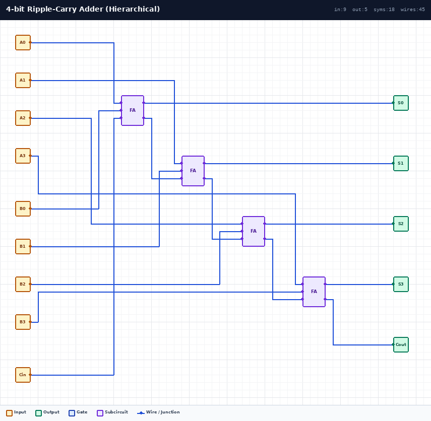

# Practical Guide, Visual Gallery (`preview`) & CLI

All schematic images below were **generated directly by [`pylogiccircuit.preview`](../src/pylogiccircuit/preview.py)** (`render_circuit_png`) from the runnable examples in this repository. You can regenerate every image at any time with:

```bash
python scripts/generate_docs_images.py
```

---

## 1. Basic Example: 1-bit Half Adder

Full source in [`examples/half_adder.py`](../examples/half_adder.py):

```python
from pylogiccircuit import Gate, Project, Simulator, render_circuit_png

proj = Project("Half Adder Demo")
ha = proj.add_circuit("HalfAdder", notation="HA")

a = ha.add_input("A", x=2, y=2)
b = ha.add_input("B", x=2, y=8)

xor_gate = ha.add_gate(Gate.XOR2, x=10, y=2)
and_gate = ha.add_gate(Gate.AND2, x=10, y=8)

s = ha.add_output("S", x=18, y=3)
c = ha.add_output("C", x=18, y=9)

ha.connect(a, xor_gate.in_[0], and_gate.in_[0])
ha.connect(b, xor_gate.in_[1], and_gate.in_[1])
ha.connect(xor_gate.out, s)
ha.connect(and_gate.out, c)

ha.auto_route()
proj.save("half_adder.CircuitProject")
render_circuit_png(ha, "docs/images/half_adder.png", scale=20)
```

### Rendered Preview


### Verified Truth Table (`Simulator`)

| A | B | S | C |
| :-: | :-: | :-: | :-: |
| 0 | 0 | 0 | 0 |
| 0 | 1 | 1 | 0 |
| 1 | 0 | 1 | 0 |
| 1 | 1 | 0 | 1 |

Notice in the preview above:
- Filled blue dots mark **electrical T-junctions** where `A` and `B` branch into both `XOR` and `AND`.
- Where the vertical wire from `A` crosses the horizontal wire from `B`, there is **no dot** — matching LogicCircuit's non-connecting perpendicular crossing rule.

---

## 2. Hierarchical Subcircuits: 1-bit Full Adder → 4-bit Ripple-Carry Adder

Full source in [`examples/full_adder_4bit.py`](../examples/full_adder_4bit.py).

First, we define a reusable `FullAdder` (`FA`) subcircuit with 2 `XOR2`, 2 `AND2`, and 1 `OR2` gates:


Next, we instantiate `FullAdder` **4 times** inside `Adder4Bit` via `top.add_subcircuit(fa, ...)` and ripple the carry across stages (`FA0.Cout → FA1.Cin → FA2.Cin → FA3.Cin → Cout`):



- Exhaustive verification performed by the example: **`512 / 512`** combinations (`A ∈ [0..15]`, `B ∈ [0..15]`, `Cin ∈ {0, 1}`) passed.

---

## 3. Complete Design: 4-bit ALU (`74LS382 / 74HC382`)

Full source in [`examples/alu_4bit_74ls382.py`](../examples/alu_4bit_74ls382.py).

This ALU implements the complete `74LS382 / 74HC382` function table using **one 4-bit adder (`74HC283`)**, programmable `XOR` input inverters (`Inv_A` / `Inv_B`), a 3-gate signed overflow detector (`OVR = (X3 ⊙ Y3) · (X3 ⊕ S3)`), and four 1-bit output selectors (`BitMux`):

| `S2` | `S1` | `S0` | Operation | Output `F3..F0` |
| :-: | :-: | :-: | --- | --- |
| `0` | `0` | `0` | `CLEAR` | `0000` |
| `0` | `0` | `1` | `B - A` | `~A + B + Cn` (with `Cn+4` and `OVR`) |
| `0` | `1` | `0` | `A - B` | `A + ~B + Cn` (with `Cn+4` and `OVR`) |
| `0` | `1` | `1` | `A + B` | `A + B + Cn` (with `Cn+4` and `OVR`) |
| `1` | `0` | `0` | `A XOR B` | `A ⊕ B` |
| `1` | `0` | `1` | `A OR B` | `A + B` (bitwise) |
| `1` | `1` | `0` | `A AND B` | `A · B` (bitwise) |
| `1` | `1` | `1` | `PRESET` | `1111` |

### Internal Subcircuit `BitMux` (1-bit Output Selector)


### Top-Level `ALU_74LS382` (39 symbols, 210 wires)


- Exhaustive verification performed by the example: **`4096 / 4096`** combinations (`8 ops × 2 carries × 16 A × 16 B`) passed for `F3..F0`, `Cn+4`, and `OVR`.

---

## 4. Sequential Circuits & Oscillation Detection

`pylogiccircuit`'s FIFO simulator supports feedback loops in latches and flip-flops — converging cleanly without false oscillation errors — while accurately flagging true unstable loops (such as ring oscillators).

### Active-Low SR Latch (Cross-Coupled `NAND2` Gates)


Truth table produced by `Simulator.truth_table("SRLatch")`:

| `S_n` | `R_n` | `Q` | `Qn` | State |
| :-: | :-: | :-: | :-: | --- |
| `0` | `0` | `1` | `1` | Forbidden (`S_n=R_n=0`) |
| `0` | `1` | `1` | `0` | `SET` (`Q = 1`) |
| `1` | `0` | `0` | `1` | `RESET` (`Q = 0`) |
| `1` | `1` | `0` | `1` | `HOLD` (retains previous state `0, 1`) |

---

## 5. Command-Line Interface (CLI)

Installing the package exposes the `pylogiccircuit` executable (also runnable via `python -m pylogiccircuit.cli`).

### `list` — List circuits in a `.CircuitProject`
```bash
pylogiccircuit list alu_74ls382.CircuitProject
```
Output:
```text
FullAdder (FA) — inputs=3, outputs=2, symbols=10, wires=34
Adder4 (74HC283) — inputs=9, outputs=5, symbols=18, wires=45
BitMux (MUX) — inputs=6, outputs=1, symbols=20, wires=104
ALU_74LS382 (74LS382) — inputs=12, outputs=6, symbols=39, wires=210
```

### `verify` — Audit wire geometry
```bash
pylogiccircuit verify alu_74ls382.CircuitProject
# For legacy hand-drawn files containing diagonal wires:
pylogiccircuit verify my_file.CircuitProject --allow-diagonal
```

### `truth-table` — Print a Markdown truth table
```bash
pylogiccircuit truth-table alu_74ls382.CircuitProject --circuit FullAdder
# Optionally cap output rows for large circuits:
pylogiccircuit truth-table alu_74ls382.CircuitProject --circuit ALU_74LS382 --max-rows 16
```

### `render` — Export a PNG schematic preview
```bash
pylogiccircuit render alu_74ls382.CircuitProject --circuit ALU_74LS382 -o alu_preview.png --scale 14
```
