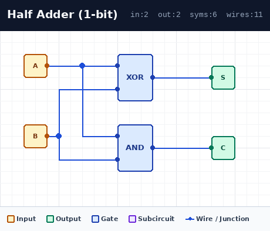
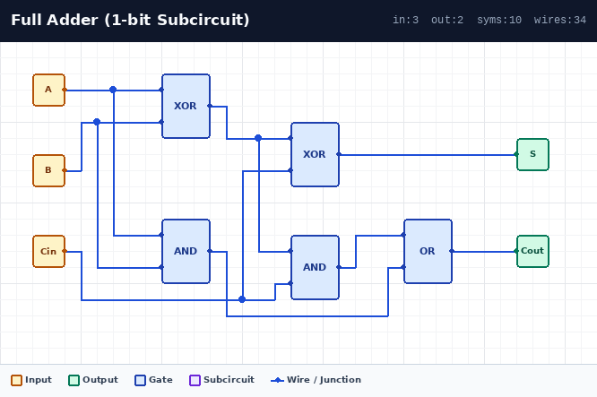
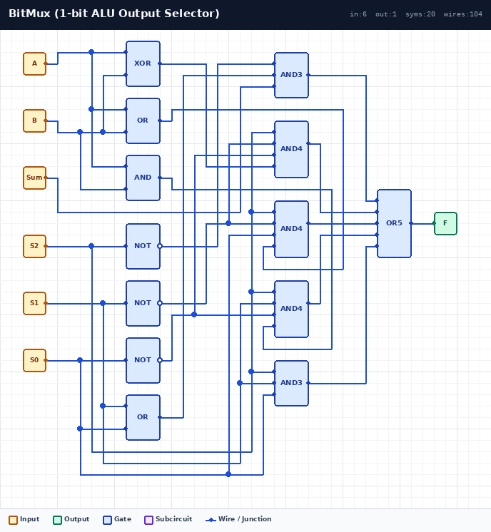
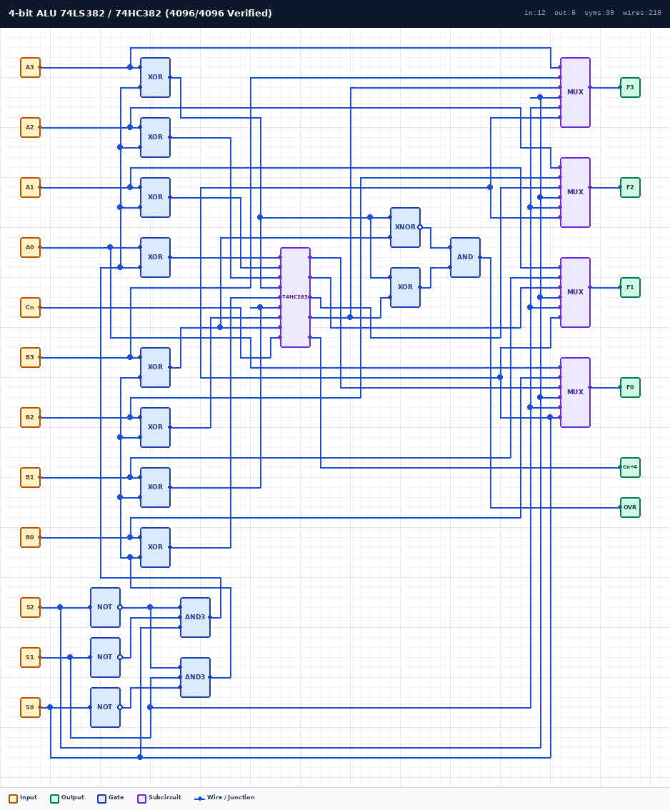
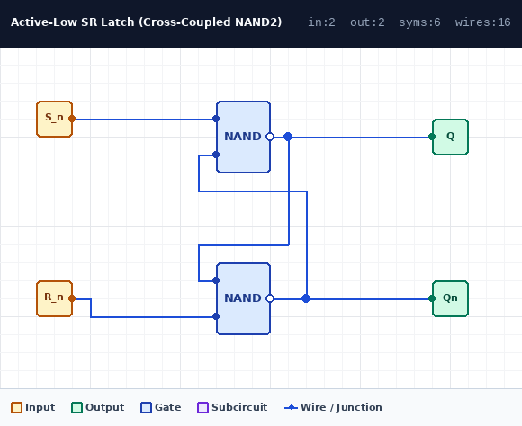

# Guia Prático, Galeria Visual (`preview`) e CLI

Todas as imagens abaixo foram **geradas diretamente pelo módulo [`pylogiccircuit.preview`](../src/pylogiccircuit/preview.py)** (`render_circuit_png`) executando os circuitos reais do repositório. Você pode regenerar todas elas a qualquer momento com:

```bash
python scripts/generate_docs_images.py
```

---

## 1. Exemplo Básico: Half Adder (Meio Somador 1-bit)

Código completo em [`examples/half_adder.py`](../examples/half_adder.py):

```python
from pylogiccircuit import Gate, Project, Simulator, render_circuit_png

proj = Project("Half Adder Demo")
ha = proj.add_circuit("HalfAdder", notation="HA")

a = ha.add_input("A", x=2, y=2)
b = ha.add_input("B", x=2, y=8)

xor_gate = ha.add_gate(Gate.XOR2, x=10, y=2)
and_gate = ha.add_gate(Gate.AND2, x=10, y=8)

s = ha.add_output("S", x=18, y=3)
c = ha.add_output("C", x=18, y=9)

ha.connect(a, xor_gate.in_[0], and_gate.in_[0])
ha.connect(b, xor_gate.in_[1], and_gate.in_[1])
ha.connect(xor_gate.out, s)
ha.connect(and_gate.out, c)

ha.auto_route()
proj.save("half_adder.CircuitProject")
render_circuit_png(ha, "docs/images/half_adder.png", scale=20)
```

### Prévia gerada pelo `preview`



### Tabela-Verdade validada pelo `Simulator`

| A | B | S | C |
| :-: | :-: | :-: | :-: |
| 0 | 0 | 0 | 0 |
| 0 | 1 | 1 | 0 |
| 1 | 0 | 1 | 0 |
| 1 | 1 | 0 | 1 |

Note no esquemático acima:
- Os pontos azuis preenchidos indicam **junções elétricas em T** (`A` e `B` se bifurcando para `XOR` e `AND`).
- O cruzamento entre o fio vertical de `A` e o fio horizontal de `B` **não tem ponto** — exatamente como o LogicCircuit representa cruzamentos sem curto.

---

## 2. Subcircuitos Hierárquicos: Full Adder 1-bit → Somador 4-bit

Código completo em [`examples/full_adder_4bit.py`](../examples/full_adder_4bit.py).

Primeiro criamos o subcircuito reutilizável `FullAdder` (`FA`) com 2 portas `XOR2`, 2 `AND2` e 1 `OR2`:



Depois instanciamos `FullAdder` **4 vezes** dentro de `Adder4Bit` com `top.add_subcircuit(fa, ...)` encadeando o *carry* (`FA0.Cout → FA1.Cin → FA2.Cin → FA3.Cin → Cout`):


- Verificação exaustiva executada pelo exemplo: **`512 / 512`** combinações (`A ∈ [0..15]`, `B ∈ [0..15]`, `Cin ∈ {0, 1}`) aprovadas.

---

## 3. Projeto Completo: ALU 4-bit `74LS382 / 74HC382`

Código completo em [`examples/alu_4bit_74ls382.py`](../examples/alu_4bit_74ls382.py).

A ALU implementa integralmente a tabela de funções do CI `74LS382 / 74HC382` usando **apenas 1 somador de 4 bits (`74HC283`)**, inversores controlados por `XOR` nas entradas (`Inv_A` / `Inv_B`), detector de *overflow* de 3 portas (`OVR = (X3 ⊙ Y3) · (X3 ⊕ S3)`) e 4 seletores de saída (`BitMux`):

| `S2` | `S1` | `S0` | Operação | Saída `F3..F0` |
| :-: | :-: | :-: | --- | --- |
| `0` | `0` | `0` | `CLEAR` | `0000` |
| `0` | `0` | `1` | `B - A` | `~A + B + Cn` (com `Cn+4` e `OVR`) |
| `0` | `1` | `0` | `A - B` | `A + ~B + Cn` (com `Cn+4` e `OVR`) |
| `0` | `1` | `1` | `A + B` | `A + B + Cn` (com `Cn+4` e `OVR`) |
| `1` | `0` | `0` | `A XOR B` | `A ⊕ B` |
| `1` | `0` | `1` | `A OR B` | `A + B` (bit a bit) |
| `1` | `1` | `0` | `A AND B` | `A · B` (bit a bit) |
| `1` | `1` | `1` | `PRESET` | `1111` |

### Subcircuito interno `BitMux` (seletor de 1 bit)



### Circuito completo `ALU_74LS382` (39 símbolos, 210 fios)



- Verificação exaustiva executada pelo exemplo: **`4096 / 4096`** combinações (`8 operações × 2 carries × 16 valores de A × 16 valores de B`) aprovadas para `F3..F0`, `Cn+4` e `OVR`.

---

## 4. Circuitos Sequenciais e Detecção de Oscilação

O simulador FIFO da `pylogiccircuit` também suporta realimentação (*feedback*) em latches e flip-flops — mantendo o estado estável sem falsos erros de oscilação — e acusa oscilação real quando existe laço instável (como um *ring oscillator*).

### Latch SR ativo-baixo (2 portas `NAND2` cruzadas)



Tabela-verdade obtida via `Simulator.truth_table("SRLatch")`:

| `S_n` | `R_n` | `Q` | `Qn` | Estado |
| :-: | :-: | :-: | :-: | --- |
| `0` | `0` | `1` | `1` | Proibido (`S_n=R_n=0`) |
| `0` | `1` | `1` | `0` | `SET` (`Q = 1`) |
| `1` | `0` | `0` | `1` | `RESET` (`Q = 0`) |
| `1` | `1` | `0` | `1` | `HOLD` (mantém estado anterior `0, 1`) |

---

## 5. Guia da Interface de Linha de Comando (CLI)

Ao instalar o pacote (`pip install -e .`), o comando `pylogiccircuit` fica disponível no terminal (também acessível via `python -m pylogiccircuit.cli`).

### `list` — Listar circuitos do projeto
```bash
pylogiccircuit list alu_74ls382.CircuitProject
```
Saída esperada:
```text
FullAdder (FA) — inputs=3, outputs=2, symbols=10, wires=34
Adder4 (74HC283) — inputs=9, outputs=5, symbols=18, wires=45
BitMux (MUX) — inputs=6, outputs=1, symbols=20, wires=104
ALU_74LS382 (74LS382) — inputs=12, outputs=6, symbols=39, wires=210
```

### `verify` — Validar geometria de fios
```bash
pylogiccircuit verify alu_74ls382.CircuitProject
# Se um arquivo antigo desenhado à mão contiver fios diagonais:
pylogiccircuit verify meu_arquivo.CircuitProject --allow-diagonal
```

### `truth-table` — Gerar tabela-verdade em Markdown
```bash
pylogiccircuit truth-table alu_74ls382.CircuitProject --circuit FullAdder
# Opcionalmente limite o número de linhas para circuitos grandes:
pylogiccircuit truth-table alu_74ls382.CircuitProject --circuit ALU_74LS382 --max-rows 16
```

### `render` — Gerar imagem PNG de qualquer circuito
```bash
pylogiccircuit render alu_74ls382.CircuitProject --circuit ALU_74LS382 -o alu_preview.png --scale 14
```
